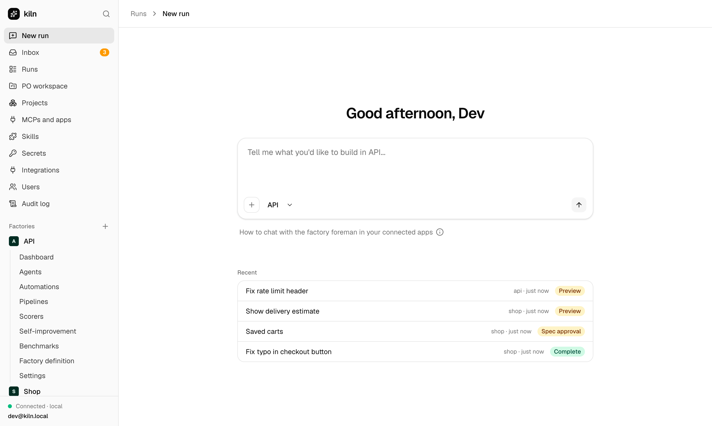

# Kiln

Open source, self-hosted software factories. A team of coding agents turns issues, Slack threads and tracker tickets into reviewed pull requests, and people approve the spec, accept the preview and merge.

- **Bring your own keys.** Claude Code runs on your Claude subscription (`claude setup-token`) or an API key; Codex and OpenCode run on your OpenAI, Anthropic or OpenRouter keys.
- **Self-hosted.** One process and a data folder to start; Docker Compose or Helm (gVisor sandboxes) for teams.
- **Factories as code.** The same layout Warp Factories exports (`factory.yaml`, `agents/`, `automations/`, `scorers/`, `skills/` …), stored in a GitHub repo you own. Merges apply automatically; Warp trees import as they are.
- **People stay in charge.** Agents push only `kiln/*` branches with short-lived tokens and can never approve or merge.



## Quickstart

```bash
pnpm install
pnpm dev                 # API on :4000 (with demo data), web app on :3000
```

Open http://localhost:3000. Out of the box everything is local: a git-backed forge, an in-process tracker and chat, and scripted agents, so you can see the whole lifecycle without accounts. To use real models, set `KILN_AGENTS=real` and one of `CLAUDE_CODE_OAUTH_TOKEN`, `ANTHROPIC_API_KEY`, `OPENAI_API_KEY` or `OPENROUTER_API_KEY`. See [Self-hosting](docs/site/infrastructure/self-hosting.md) for Docker Compose, Helm and connecting GitHub, Slack, Linear and Jira.

```bash
pnpm kiln init my-factory --template sdlc    # or single-repo, po-feature, incident
pnpm kiln validate my-factory
pnpm kiln apply my-factory                   # with KILN_URL and KILN_TOKEN set
pnpm kiln send "Fix the typo in the README" --factory <alias>
```

## How it works

A work item moves through `triaging → planning → awaiting_spec → building → awaiting_preview → reviewing → handed_off → complete`. The foreman picks the shortest path (small, clear changes skip the spec), or a pipeline file fixes the graph. Each run happens in a sandbox; every shell command passes a guardrail; evidence (tests, a video per acceptance criterion, a preview URL) is attached to the PR. Scorers grade runs, and self-improvement turns repeated failures into definition PRs that are replayed against the failing runs before a person reviews them.

Read more in the [docs](docs/site/index.md) (also served at `/docs` in the web app) and the [build plan](docs/plan/PLAN.md); [STATUS.md](docs/plan/STATUS.md) shows where each task stands.

## Repository

```text
apps/api        REST API, webhooks, MCP endpoint, timers (Hono)
apps/mcp        Kiln MCP server (streamable HTTP, scoped tokens)
apps/web        Web app (Next.js + shadcn/ui)
packages/       schema, definitions, decide, sandbox, harness, evidence,
                integrations, auth, store, events, engine, sdk-ts, cli
factories/      kiln-self (the factory that builds Kiln) and starter templates
docs/           plan, ADRs, threat model, docs site, Warp setup record
deploy/         Helm chart and the sandbox egress proxy
e2e/            end-to-end tests on a git-backed fake forge
```

## Development

```bash
pnpm typecheck && pnpm test && pnpm lint && pnpm build
pnpm docs:gen      # regenerate CLI/API/MCP/definition reference pages
```

Contributions follow [CLAUDE.md](CLAUDE.md): one task per branch, tests first, a person merges. MIT licensed.
