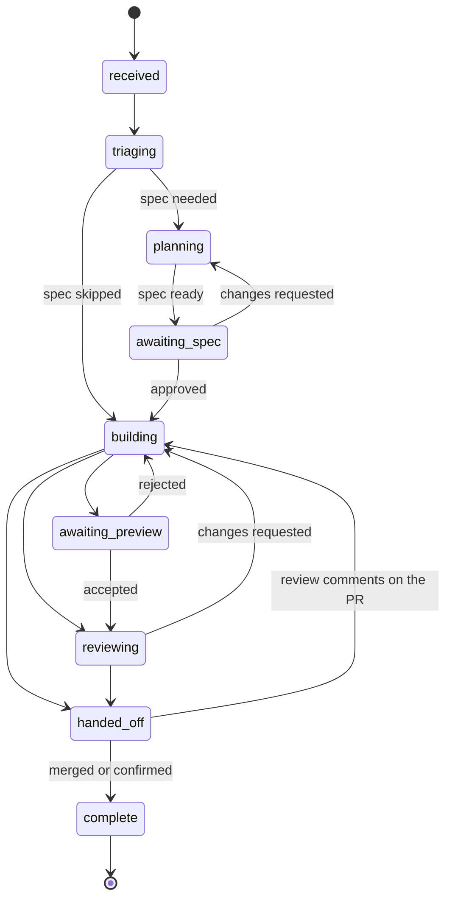

Every request becomes a work item that moves through a fixed set of states, from `received` to `complete`, and only a merge or a person's confirmation can complete it.

## Intake

A work item starts when an automation trigger matches an event, for example a GitHub issue labeled `kiln-ready`, a Slack mention of `@webapp`, a Linear agent session, a Jira issue, a schedule or a webhook. It can also start from the API, the CLI (`kiln send`) or the Kiln MCP (`send_task`).

The work item keeps its source: the Slack channel and thread, the issue, or the pull request. Kiln posts updates there. Replies in the same thread or on the same issue continue the same work item instead of starting a new one.

Each work item records the definition SHA it runs under. During a [canary](../measure-and-improve/replay-and-canary.md), some new work items get the candidate definition and the rest get the applied one.

## The foreman's default path

When the factory has no pipeline, or the work item names none, the foreman builds the path:

1. **Triage.** Kiln asks the `triage` decision for the kind (`feature`, `bug`, `chore`, `incident`, `question`) and size (`xs` to `xl`). If both answers have a probability of at least 0.6, Kiln uses them. Otherwise the `TRIAGE` agent classifies the request.
2. **Spec, when needed.** The `foreman-routing` decision answers `needs_spec`. At 0.85 or more, the item gets a spec. At 0.15 or less, it skips the spec. In between, the `FOREMAN` agent decides. If no answer comes back, sizes `m`, `l` and `xl` get a spec.
3. **Build.** The `IMPLEMENT` agent makes the change on a `kiln/<id>-<title>` branch.
4. **Verify.** The `VERIFY` agent checks the change, and Kiln waits for CI to pass. A failure loops back to build, up to 3 times.
5. **Preview.** If a preview provider is configured, Kiln deploys the branch and asks for preview acceptance.
6. **Review.** The `REVIEW` agent reviews the pull request. The review is advisory: `changes_requested` with findings loops back to build, up to 2 times. After that, Kiln posts the remaining findings on the pull request as "Advisory review findings:" and goes on to hand-off.
7. **Hand-off.** Kiln marks the pull request ready, labels it `factory:<alias>`, posts "Ready to merge" to the source thread, and opens a merge gate.

Spec and review are left out when the factory has no `SPEC` or `REVIEW` agent. Without a `VERIFY` agent, the verify stage only waits for CI. Build falls back to a `CUSTOM` agent, then to the foreman. A [pipeline](../configuration/pipelines-and-gates.md) replaces this path with stages you list.

## States

Three more states sit beside the main path:

| State | Meaning |
| --- | --- |
| `blocked` | The item is parked. Causes: a gate expired, a stage failed more than its `max_loops`, the build agent failed twice, the budget ran out, or an error stopped the run. Any active state can move here. |
| `cancelled` | A person cancelled the item, or rejected a question gate on a blocked item. Final. |
| `failed` | Reserved for work that cannot continue. The current workflow parks errors as `blocked` instead. A failed item can be retried from `received` or `building`. |

Every transition emits a `work_item.stage_changed` event with `from`, `to` and a reason.

## Where people decide

The factory pauses at gates. Each gate appears in the [inbox](../management/inbox.md) and in the source thread.

| Gate | Opens when | Built-in timing |
| --- | --- | --- |
| Spec approval | The spec is written | Nudge every 24h, park after 72h |
| Preview acceptance | The preview is deployed | Nudge every 24h, park after 72h |
| Question | A stage keeps failing, or the build agent fails twice | None |
| Command approval | The guardrail rates a shell command as risky | Waits up to 30 minutes, then blocks the command |
| Merge | The pull request is handed off | Nudge every 48h |

Rejecting a spec sends the item back to the spec stage with your feedback. Rejecting a preview sends it back to build.

## Completion

The factory never merges. A run token can push only `kiln/*` branches and cannot approve or merge. Your branch protection and reviewers do the rest. When the pull request merges, GitHub's `pull_request` webhook completes the work item. Approving the merge gate (**Confirm it landed**) instead marks it complete by human confirmation. **Request changes** on the merge gate, or a follow-up message while the work waits for its merge, sends your note to the agents: the work goes back to the build stage and returns with an updated pull request and a new merge gate. A linked Linear or Jira issue moves to its done state.

New review comments on a handed-off pull request (any review that is not an approval) send the item back to build with the comments as findings.

## Related pages

- [Concepts](concepts.md)
- [Factory agents](../configuration/agents.md)
- [Pipelines and gates](../configuration/pipelines-and-gates.md)
- [Typed decisions](../configuration/decisions.md)
- [Inbox](../management/inbox.md)
